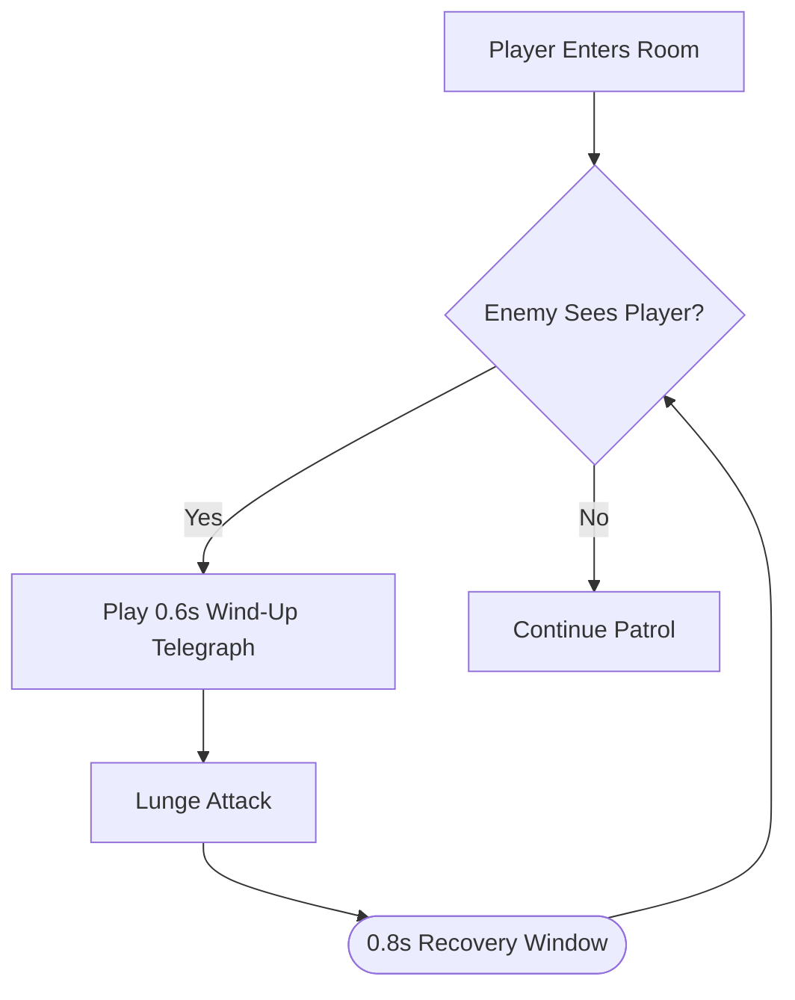

# Lanting Guard: Rush the River

## Pitch

*Lanting Guard: Rush the River* is a roguelike tower defense game inspired heavily by [Slay the Spire](https://en.wikipedia.org/wiki/Slay_the_Spire), [Clash Royale](https://en.wikipedia.org/wiki/Clash_Royale), [Bloons TD 6](https://en.wikipedia.org/wiki/Bloons_TD_6), and [Plants vs Zombies](https://en.wikipedia.org/wiki/Plants_vs._Zombies). The player traverses a node-based map and defends their [rumah lanting](https://id.wikipedia.org/wiki/Rumah_Lanting) from trash polluting the river by placing [jukung](https://id.wikipedia.org/wiki/Jukung) between waves and supporting them using items such as mud ball and fishing net.

## Core Loop

## Out of Scope

